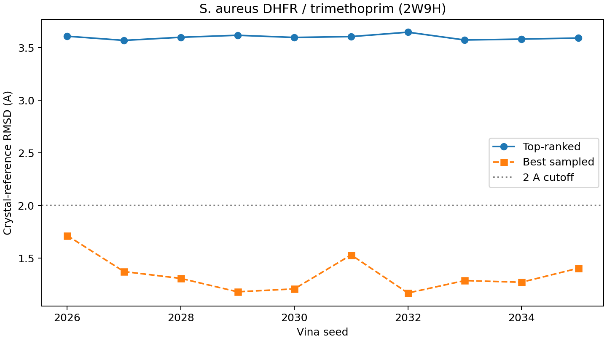
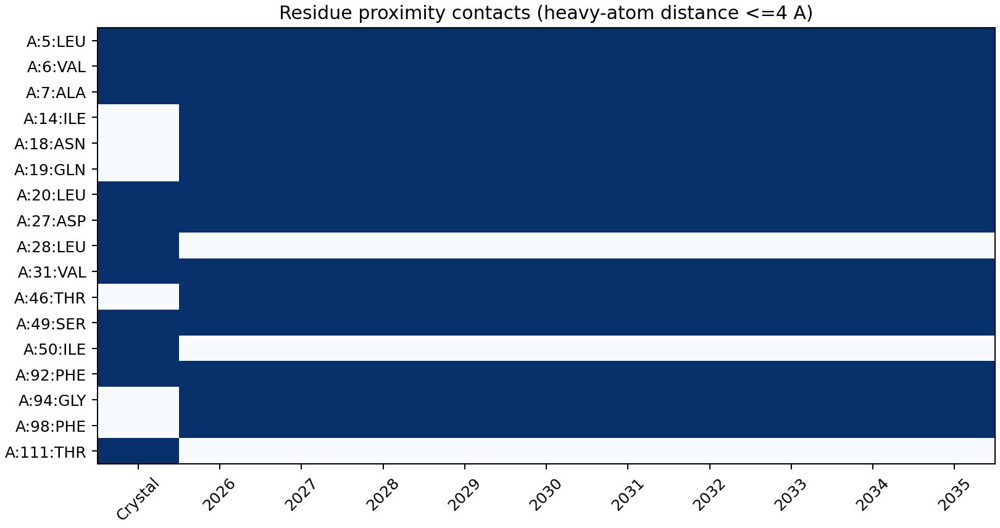
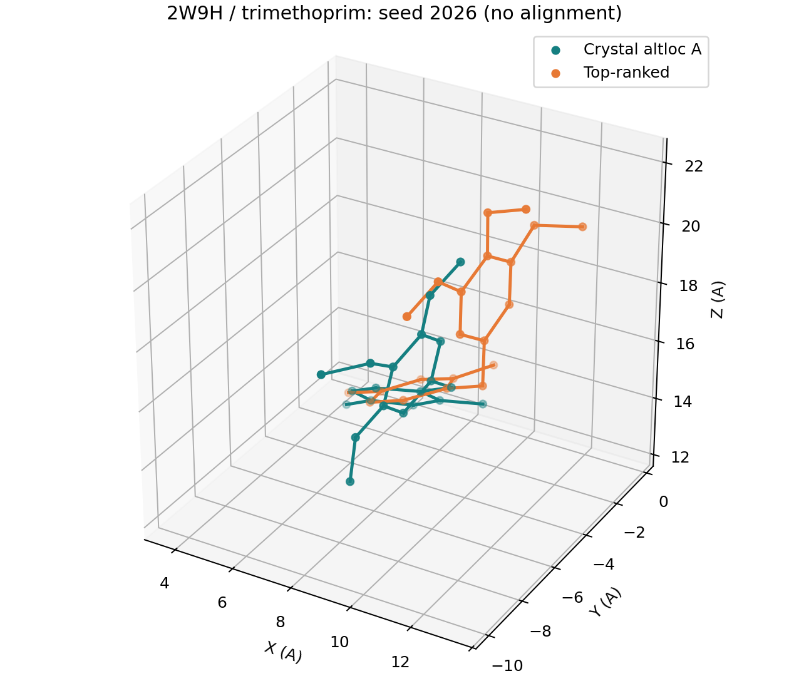

# S. aureus DHFR Docking Reproducibility

Independent SMILES ligand preparation, ten-seed AutoDock Vina docking,
crystal-reference RMSD and residue contacts for **Staphylococcus aureus DHFR–trimethoprim (2W9H)**.

[Türkçe özet](docs/README_TR.md)

The receptor is chain A of the 1.48 A structure [2W9H](https://www.rcsb.org/structure/2W9H).
Trimethoprim (CCD TOP, A1160) is the crystallographic reference. This is a
single-system pose-recovery experiment, not evidence of antibacterial efficacy,
MIC, selectivity, resistance coverage, or general docking accuracy.

## Receptor repair: Lys158 retained

The deposited Lys158 has only its N atom. We **complete Lys158**, including
CA, C, O, CB, CG, CD, CE and NZ, and add terminal OXT. PDBFixer initializes
the missing atoms; Amber14 minimization relaxes added atoms and hydrogens while
all observed heavy atoms are fixed. Meeko then prepares the rigid receptor.
Added coordinates are modeled, not experimentally observed. The full audit
lists added atoms, bond lengths and displacement of observed coordinates:
[preparation audit](data/prepared/preparation_audit.json).

Alternate location A plus shared atoms is used for protein and ligand.
Waters and ethylene glycol are removed; absent Met0 is not reconstructed.
2W9H has no NADPH in the deposited coordinates; no cofactor is invented.
Meeko default residue templates determine receptor protonation. These choices
are fixed modeling assumptions, not a pKa or protonation-ensemble calculation.

## Experiment

[Protocol](configs/protocol.json): one ETKDGv3/MMFF94s conformer generated only
from SMILES, then seeds 2026–2035; Vina 1.2.7, CPU 2 per run,
exhaustiveness 32, up to 20 modes, energy range 5 kcal/mol. The 22 A cube is
centered on the reference heavy-atom centroid. Crystal coordinates define the
known site and validation reference, not the starting ligand conformation.
Trimethoprim is modeled in the neutral CCD state (formal charge 0); alternative
protonation states may change the results.

The primary endpoint is the number of top-ranked poses with RMSD <2 A.
The secondary endpoint is the number of runs sampling at least one pose <2 A.
Sampling and ranking are reported separately. RMSD uses symmetry-aware RDKit
`CalcRMS` in the receptor frame, with hydrogens excluded and **no ligand
alignment**. Chemical identity and charge must match. Vina's relative RMSD
columns are not crystal-reference RMSDs. Contacts use minimum heavy-atom
distance <=4 A and do not assign hydrogen bonds or other interaction types.

## Saved results (exhaustiveness 32)

| Endpoint | Result |
|---|---:|
| Top-ranked pose RMSD <2 A | 0/10 runs |
| At least one sampled pose RMSD <2 A | 10/10 runs |
| Top-ranked RMSD, mean ± sample SD | 3.599 ± 0.023 A |
| Top-ranked RMSD, median | 3.598 A |
| Top-ranked RMSD range | 3.569–3.647 A |
| Returned poses | 200 |
| Mean native-contact recall, top-ranked | 72.7% |

Vina samples near-native poses in every run but does not rank them first in
this fixed neutral-ligand model. Lower-ranked successes do not count as
top-rank successes. The best-sampled ranks range from 7 to 14.



| Seed | Top-ranked RMSD (A) | Best-sampled RMSD (A) | Best-sampled rank |
|---|---:|---:|---:|
| 2026 | 3.609 | 1.715 | 14 |
| 2027 | 3.569 | 1.373 | 7 |
| 2028 | 3.599 | 1.308 | 8 |
| 2029 | 3.617 | 1.181 | 9 |
| 2030 | 3.597 | 1.209 | 14 |
| 2031 | 3.605 | 1.531 | 13 |
| 2032 | 3.647 | 1.169 | 10 |
| 2033 | 3.573 | 1.288 | 13 |
| 2034 | 3.581 | 1.272 | 13 |
| 2035 | 3.591 | 1.405 | 7 |

[All poses](experiments/independent/analysis/all_poses.csv),
[per-run metrics](experiments/independent/analysis/per_run.csv),
[summary](experiments/independent/analysis/summary.json),
[integrity manifest](experiments/independent/manifest.json).





## Run

For analysis of saved evidence (Python 3.13):

```bash
python -m pip install -r requirements.txt
python -m unittest discover -s tests -v
python scripts/analyze.py
python scripts/plot_results.py
```

Install the [official AutoDock Vina 1.2.7 executable](https://github.com/forlilab/AutoDock-Vina/releases/tag/v1.2.7) separately, then:

```bash
python scripts/run_pipeline.py --vina /path/to/vina --output experiments/rerun1 --jobs 2
```

On Windows use a path to `vina.exe`. Each job uses two CPU threads.
New runs copy the fixed prepared inputs and protocol, record executable/input/output
SHA-256 hashes, save exact commands and raw logs, then regenerate the analyses.
Existing run directories are refused rather than silently overwritten or reused.

To rebuild the receptor and independent ligand from the archived PDB and CCD:

```bash
conda env create -f environment.yml
conda activate saureus-dhfr
python scripts/prepare.py --output build/prepared
```

Review the rebuilt audit before replacing canonical `data/prepared` inputs.
The Conda file is an environment specification, not a platform-independent lockfile.
Rebuilding modeled atoms can depend on numerical libraries; saved prepared inputs
are the reproducibility baseline. The repair uses PDBFixer/OpenMM, which are not
needed to analyze archived docking results. No executable is bundled.

## Files

| Path | Contents |
|---|---|
| `configs/` | Fixed experiment protocol |
| `data/raw/` | Unmodified PDB 2W9H and TOP chemical component dictionary |
| `data/prepared/` | Observed/repaired/prepared receptor, reference and independent ligand, audit |
| `experiments/independent/` | Fixed inputs, ten raw outputs/logs, hashes and analysis |
| `experiments/exploratory_nadph_protonation/` | Post hoc add-on: grafted NADPH and N1-protonated ligand (see [docs](docs/EXPLORATORY_NADPH_PROTONATION.md)); does not replace the primary result |
| `scripts/` | Preparation, orchestration and analysis |
| `tests/` | Chemistry, reference-frame, repair and parser checks |
| `notebooks/` | Guided saved-evidence validation (requires Jupyter separately) |
| `docs/` | Methods, provenance and limitations |

GitHub Actions validates saved evidence and uploads regenerated reports; it does
not run ten new dockings or claim that Windows and Linux are bitwise identical.
The local environment is recorded in the preparation/run manifests.

## Scientific limits and references

Ten seeds measure repeatability for one conformer, one receptor and one
protonation model. This is cognate self-docking at a known binding site.
Protein flexibility, alternative crystallographic ligand positions, retained
waters, protonation ensembles and biochemical testing are outside this experiment.
Lys158 modeling introduces additional uncertainty even though it is remote from
the reference ligand. No historical native-coordinate baseline is claimed.

- Heaslet et al. (2009), structural comparison of S. aureus DHFR complexes.
  [doi:10.1002/prot.22383](https://doi.org/10.1002/prot.22383).
- Structure: [doi:10.2210/pdb2W9H/pdb](https://doi.org/10.2210/pdb2W9H/pdb).
- Eberhardt et al. (2021), AutoDock Vina 1.2.0.
  [doi:10.1021/acs.jcim.1c00203](https://doi.org/10.1021/acs.jcim.1c00203).
- [RDKit CalcRMS documentation](https://www.rdkit.org/docs/source/rdkit.Chem.rdMolAlign.html).
- [Meeko](https://github.com/forlilab/Meeko), [PDBFixer](https://github.com/openmm/pdbfixer),
  [OpenMM](https://openmm.org/).

Original code is MIT licensed. Structural data retain their scientific attribution;
see [provenance](docs/PROVENANCE.md).
